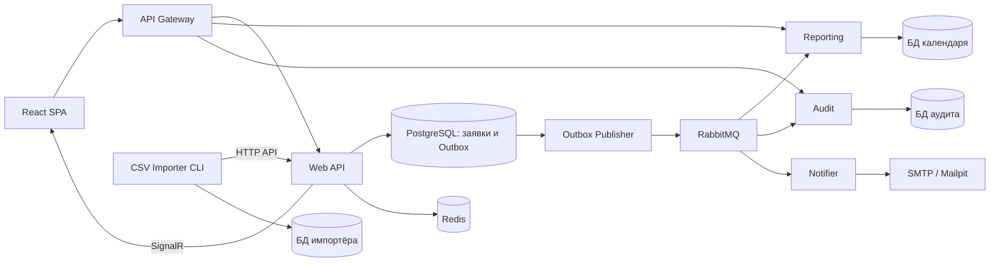

# Vacation Planner — планирование отпусков и импорт заявок

Учебный командный проект курса **OTUS «C# Developer. Professional»**: веб-приложение для сотрудников и руководителей и отдельный CLI-импортёр заявок из CSV.

**Данил** — основное приложение, обработка заявок и взаимодействие сервисов. **Дильшат** — `VacationPlanner.Importer`: CSV, задачи импорта, обработка ошибок, параллелизм и восстановление.

**Стек:** C# / .NET 10, ASP.NET Core, React + Vite, PostgreSQL, EF Core, RabbitMQ + MassTransit, Redis, SignalR, Docker Compose, Prometheus, Grafana, xUnit.

## Что умеет приложение

- Вход с JWT и ролями, refresh-токены и регистрация с подтверждением почты.
- Создание заявки, сохранение черновика, отправка на согласование и отмена.
- Утверждение и отклонение заявки непосредственным руководителем сотрудника.
- Годовой отпуск, больничный и отпуск без сохранения заработной платы.
- Проверка пересечений и годового лимита. Заявки `Submitted` и `Approved` резервируют дни годового отпуска; на границе лет учитывается часть периода каждого года.
- Баланс вычисляется по актуальным заявкам в основной БД при каждом запросе; ответ помечен `Cache-Control: no-store`. Redis используется для других данных, включая список пользователей и коды регистрации.
- Календарь отдела с пересечениями, документы-вложения и справочник праздничных дней.
- Уведомления по email, история операций и обновления интерфейса через SignalR.
- Массовая загрузка заявок из CSV с журналом задач, ошибками строк и защитой от повторных UUID.
- Метрики бизнес-операций и состояния шести постоянно работающих .NET-сервисов.

## Быстрый запуск

Нужны Git и Docker Desktop с запущенным Linux Engine. Для сборки целиком в Docker установка .NET и Node.js на хост не требуется.

```powershell
git clone https://github.com/DanilUfa/Otus_project.git
cd Otus_project
docker compose up -d --build --wait
```

Откройте **[приложение](http://localhost:5000)**. Миграции и демонстрационные пользователи создаются автоматически.

| Роль | Почта | Пароль |
|---|---|---|
| Руководитель | `manager@vac.local` | `Manager123!` |
| Сотрудник | `petr@vac.local` | `User123!` |
| Сотрудник | `maria@vac.local` | `User123!` |
| Сотрудник | `alex@vac.local` | `User123!` |

Настройки и учётные данные Compose предназначены для локальной демонстрации. При развёртывании вне неё замените пароли и JWT-ключ и настройте HTTPS.

| Компонент | Адрес | Вход |
|---|---|---|
| Приложение / Gateway | http://localhost:5000 | Учётные записи выше |
| Swagger основного API | http://localhost:5000/swagger | — |
| Основной API напрямую | http://localhost:5100 | JWT |
| Reporting / Swagger | http://localhost:5200/swagger | JWT для защищённых методов |
| Audit / Swagger | http://localhost:5300/swagger | JWT для защищённых методов |
| Письма Mailpit | http://localhost:8025 | — |
| RabbitMQ Management | http://localhost:15672 | `vac` / `vac` |
| Prometheus Targets | http://localhost:9090/targets | — |
| Grafana | http://localhost:3000 | `admin` / `admin` |

Остановить контейнеры, сохранив тома БД: `docker compose down`. Повторно запустить собранные образы: `docker compose up -d --no-build --wait`.

## Архитектура и путь заявки



1. Интерфейс передаёт заявку через Gateway. API определяет сотрудника по JWT, проверяет даты, пересечения и лимит.
2. `LeaveService` сохраняет заявку и событие в Outbox **в одной транзакции** PostgreSQL.
3. Фоновый издатель отправляет событие в RabbitMQ. Неудачная отправка повторяется.
4. Notifier отправляет письмо, Audit сохраняет историю, Reporting обновляет модель календаря. Сервисы аудита и календаря используют собственные логические базы PostgreSQL.
5. При изменении статуса выполняется аналогичный обмен событиями; SignalR сообщает интерфейсу об изменениях.

Календарь, аудит и письма обновляются асинхронно, поэтому после ответа API возможна небольшая задержка. Scheduler выполняет периодические задачи очистки черновиков и refresh-токенов.

## CSV-импортёр

`VacationPlanner.Importer` — отдельная консольная команда. Она создаёт заявки через API, сохраняя бизнес-проверки основного приложения. Пользователь CSV должен совпадать с владельцем JWT.

```csv
RequestId,UserId,Type,StartDate,EndDate,Reason
6d77cbeb-0acb-4982-8ec0-b4200b3b9a01,2,Sick,2030-05-06,2030-05-07,Medical leave
6d77cbeb-0acb-4982-8ec0-b4200b3b9a02,2,Unpaid,2030-06-10,2030-06-11,"Demo, day off"
```

`RequestId` — UUID строки импорта, а не ID созданной заявки. Для нового импорта используйте новые UUID и свободные даты. Поля и ограничения описаны в [формате CSV](docs/importer/CSV_FORMAT.md).

Возможности импортёра:

- Preflight структуры и ограничений файла до создания задачи.
- Собственная БД PostgreSQL: задачи, ошибки с номерами строк и журнал отправок.
- Асинхронный итератор CSV, ограниченный `Channel` и пул обработчиков: по умолчанию 4 workers и очередь на 16 записей.
- Упорядочивание зависимых строк, `SemaphoreSlim` для фиксации результатов и PostgreSQL advisory lock для одного активного импорта на БД.
- Частичный успех: ошибки строк не отменяют уже подтверждённые результаты.
- Обнаружение повторного `RequestId`, heartbeat, отмена и восстановление зависших задач.

Команды: `migrate`, `import --file <csv>`, `list`, `status --job <id>`, `errors --job <id>`, `dispatches --job <id>`, `recover`.

### Подготовленная демонстрация на Windows

Сначала поднимите основной стек и соберите образ импортёра:

```powershell
docker compose up -d --build --wait
docker compose --profile importer build importer
.\demo-importer.bat
```

Сценарий открывает приложение и делает паузы перед каждым этапом:

| Шаг | Ожидаемый результат |
|---|---|
| Две корректные строки | `Imported=2 Errors=0` |
| Смешанный CSV: корректная строка, неверная дата, пересечение | `Imported=1 Errors=2` |
| Повтор первого файла с прежними UUID | `Imported=0 Errors=2`, ошибки `Duplicate` |
| Неверный заголовок CSV | Отказ preflight без новой задачи |
| Сверка с API | Ровно три созданные заявки |

Каждый полный показ добавляет три заявки Петра с меткой `import-demo-...`. Сценарий выбирает свободные даты и новые UUID. У демонстрационного импортёра отдельная БД; он обращается напрямую к API в сети `vacation_vacnet`.

- `.\demo-importer.bat --check` — проверка готовности без импорта.
- `.\demo-importer.bat --auto` — полный прогон без пауз и открытия браузера.
- [Памятка для демонстрации](demo-importer-help.txt) — что показывать и говорить.
- CSV, журнал и `result.json`: `.local-demo/importer/runs/<метка>`; каталог исключён из Git и Docker context.
- Пароль демонстрационной БД сохраняется через Windows DPAPI. Файл `.local-demo/importer/db-password.xml` нужен для повторного запуска с тем же томом БД.

Для обычной работы с профилем `importer`, переменными окружения и CLI см. [инструкцию модуля](src/VacationPlanner.Importer/README.md).

## Что применено из курса

| Тема | Реализация |
|---|---|
| Базы данных и EF Core | Миграции, репозитории, отдельные хранилища заявок, аудита, календаря и импорта |
| Асинхронность | HTTP, EF Core, чтение CSV, ожидание блокировок, обработка сообщений |
| Синхронизация | `BalanceGate` с блокировкой на сотрудника; Channel, SemaphoreSlim и advisory lock в импортёре |
| Builder | [LeaveRequestBuilder](src/VacationPlanner.Application/Patterns/LeaveRequestBuilder.cs): пошаговое создание заявки |
| State | [LeaveState](src/VacationPlanner.Application/Patterns/LeaveState.cs): допустимые переходы статусов |
| Adapter | [EmailNotificationSender](src/VacationPlanner.Infrastructure/Notifications/EmailNotificationSender.cs) и [LeaveApi](src/VacationPlanner.Importer/Http/LeaveApi.cs): интеграция внешних интерфейсов |
| Facade | [ImportRunner](src/VacationPlanner.Importer/ImportRunner.cs): запуск всего процесса импорта через один метод |
| Iterator | [CsvSnapshot](src/VacationPlanner.Importer/Csv/CsvSnapshot.cs): выдача записей через `yield return` / `await foreach` |
| Интеграция приложений | RabbitMQ/MassTransit, publish/subscribe, Transactional Outbox, отдельная read-модель календаря |
| Тестирование и мониторинг | xUnit, интеграционные тесты PostgreSQL, Prometheus и Grafana |

## Сборка и тестирование

Для сборки на хосте нужны **.NET 10 SDK** и **Node.js с npm**. `global.json` выбирает стабильный SDK ветки .NET 10.

```powershell
.\build.ps1        # React + решение, Release
.\build.ps1 -Test  # тесты решения и консольные smoke-проверки
```

Скрипт также ищет SDK в `%LOCALAPPDATA%\Microsoft\dotnet`, если он установлен без прав администратора. SPA собирается в `src/VacationPlanner.Web/wwwroot`, DLL — в `bin/Release/net10.0` проектов.

При последней полной проверке прошли **93 теста**: 60 основной части и 33 импортёра. Из тестов импортёра 6 требуют PostgreSQL и без настройки подключения помечаются как пропущенные.

```powershell
# Обычный запуск тестов
dotnet test VacationPlanner.sln -c Release

# Полный запуск с интеграционными тестами импортёра
$env:IMPORTER_TEST_POSTGRES = 'Host=127.0.0.1;Port=55432;Database=postgres;Username=importer'
# Пароль БД можно передать через PGPASSWORD.
dotnet test VacationPlanner.sln -c Release
```

Для интеграционных тестов роли PostgreSQL нужны права `CREATEDB`. Тесты создают отдельные БД со случайными именами, применяют миграции и удаляют свои БД после завершения. [Подробности проверки импортёра](src/VacationPlanner.Importer/README.md#проверка-и-демонстрация-otus).

Проверки работающего приложения (нужны запущенный Docker-стек и Node.js):

```powershell
node tests/gateway-chunked-smoke.mjs  # передача потокового JSON через Gateway
node tests/balance-freshness-smoke.mjs # актуальность баланса после изменения заявок
```

Проверка баланса подбирает свободные годы, создаёт две тестовые заявки и проверяет
подачу, утверждение, отмену, отправку черновика и отклонение без ожидания TTL.
После проверки заявки остаются в истории со статусами Cancelled/Declined.

### Режим разработки

```powershell
.\run-dev.ps1
# Отдельный Vite dev server при необходимости:
npm --prefix src/VacationPlanner.Web/ClientApp run dev
```

`run-dev.ps1` собирает решение и запускает шесть сервисов на хосте, инфраструктуру — в Docker. Он использует `docker-compose.host.yml` и `prometheus/prometheus.host.yml`. Требуется .NET 10, доступный команде `dotnet`; SPA предварительно собирается через `build.ps1`. Остановка процессов: `.\stop-dev.ps1`.

## Мониторинг

Prometheus опрашивает `/metrics` шести постоянно работающих .NET-сервисов каждые **5 секунд** напрямую по Docker DNS. В [Targets](http://localhost:9090/targets) у всех шести целей должен быть статус `UP`.

Дашборды Grafana подключаются автоматически; вход `admin` / `admin`:

- [Заявки](http://localhost:3000/d/vacation-overview): поданные, утверждённые и отклонённые заявки, скорость утверждений.
- [Сервисы](http://localhost:3000/d/vacation-services): CPU, resident-память, managed heap, HTTP RPS, p95 длительности запросов, HTTP 4xx/5xx, предупреждения и ошибки логов.

Бизнес-счётчики: `vacation_leaves_submitted_total`, `vacation_leaves_approved_total`, `vacation_leaves_declined_total`. Они доступны непосредственно у API на http://localhost:5100/metrics. Gateway на `:5000/metrics` экспортирует собственные метрики процесса и HTTP.

CPU отображается как процент одного ядра; метрики памяти относятся к процессам .NET. Это не мониторинг ресурсов всего ПК, PostgreSQL, Redis или RabbitMQ. Для Notifier и Scheduler ошибки видны через счётчики логов. CLI-импортёр не входит в шесть постоянно опрашиваемых сервисов; его результаты сохраняются в БД задач.

Счётчики сбрасываются при перезапуске процесса; `rate` и `increase` учитывают сброс. Без наблюдений p95 не определён. Health-запросы входят в HTTP-нагрузку, `/metrics` исключён на дашборде. После ручного изменения конфигурации Prometheus: `docker compose restart prometheus`.

## API

Полная спецификация — в Swagger. Основные маршруты:

| Назначение | Маршрут |
|---|---|
| Вход / refresh / logout | `POST /api/auth/login`, `/api/auth/refresh`, `/api/auth/logout` |
| Регистрация и подтверждение | `POST /api/auth/register`, `/api/auth/register/confirm` |
| Список пользователей и заявок | `GET /api/users`, `GET /api/leave` |
| Подача / черновик | `POST /api/leave`, `POST /api/leave/draft` |
| Жизненный цикл | `POST /api/leave/{id}/submit`, `/cancel`, `/approve`, `/decline` |
| Баланс | `GET /api/balance/{userId}?year=2030` |
| Вложения | `POST /api/leave/{id}/attachments`, `GET /api/leave/{id}/attachments` |
| Календарь | `GET /api/reports/calendar?year=2030` |
| История | `GET /api/audit?requestId={id}` |
| Состояние | `GET /health/live`, `GET /health/ready` |

Бизнес-методы защищены JWT. Сотрудник получает свои заявки; руководитель может просматривать список и согласовывать заявки своих сотрудников. Справочник праздников: `GET /api/holidays?year=2030`. Типы отсутствия в JSON: `0 = Annual`, `1 = Sick`, `2 = Unpaid`.

## Структура репозитория

```text
src/
  VacationPlanner.Domain/          Сущности, статусы, контракты событий
  VacationPlanner.Application/     Прикладные сервисы, интерфейсы, паттерны
  VacationPlanner.Infrastructure/  EF Core, репозитории, безопасность, email
  VacationPlanner.Web/             Основной API, React SPA, SignalR, Outbox
  VacationPlanner.Gateway/         HTTP Gateway
  VacationPlanner.Notifier/        Email-подписчики
  VacationPlanner.Audit/           История операций и её API
  VacationPlanner.Reporting/       Модель календаря и её API
  VacationPlanner.Scheduler/       Фоновые задачи очистки
  VacationPlanner.Observability/   Общие метрики процессов, HTTP и логов
  VacationPlanner.Importer/        CLI, CSV, БД импорта, собственные тесты
tests/
  VacationPlanner.UnitTests/       60 unit-тестов основной части
  VacationPlanner.Smoke/           Консольные проверки без xUnit
grafana/                           Источники данных и дашборды
prometheus/                        Конфигурации Docker и запуска на хосте
demo-importer.*                    Пошаговая демонстрация импортёра
```

## Ограничения и дальнейшая работа

- `BalanceGate` упорядочивает расчёты внутри одного экземпляра API; это не распределённая блокировка всех операций подачи.
- Дедупликация импортёра зависит от его журнала RequestId. При потере ответа после POST состояние `Unconfirmed` требует ручной сверки; автоматический повтор POST отключён. Подробнее — в инструкции импортёра.
- Настройки Compose предназначены для разработки. Внешний OIDC/Keycloak, Kafka и полноценный CI/CD пока не реализованы.
- Дальнейшие улучшения: расширение интеграционных тестов и координация при нескольких экземплярах API.
